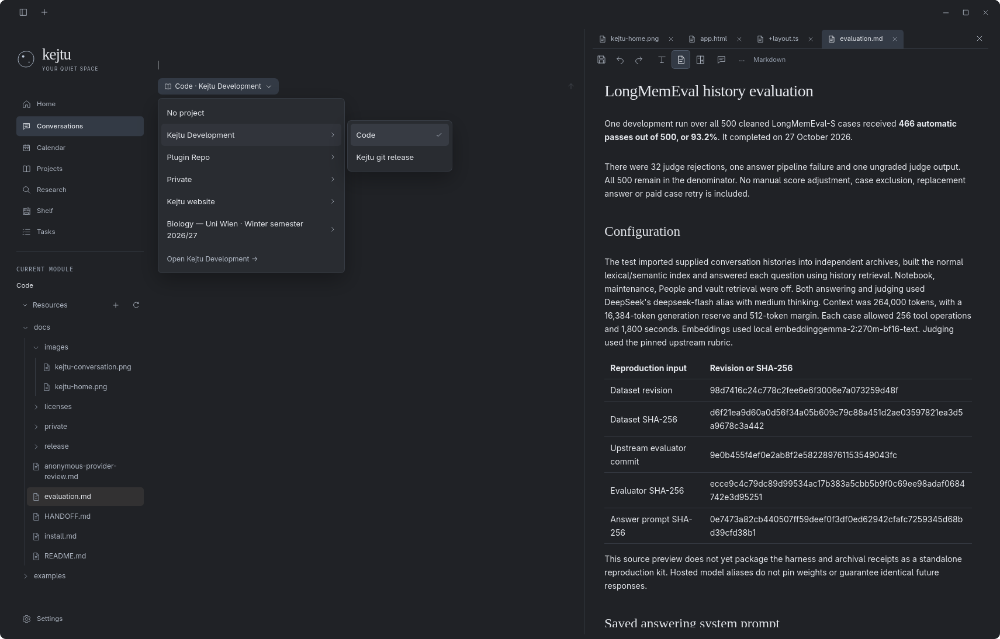
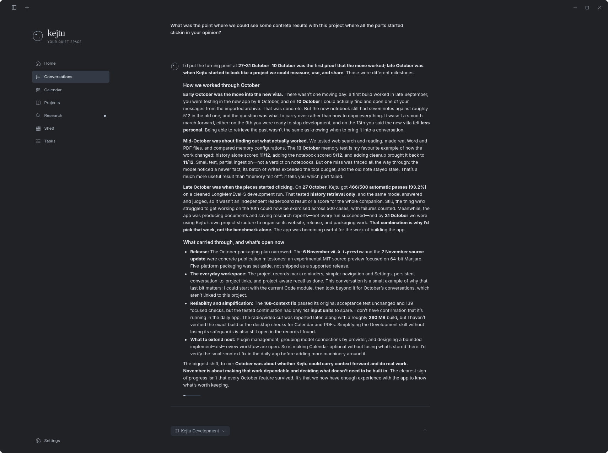

# Kejtu

A personal AI workspace that remembers what matters and can show you why.

Talk things through, plan your week, keep notes, organise projects and tasks,
research a topic and work on documents in one desktop app. Your conversations
and notes are stored on your computer.

  

## Download for Linux

[Download Kejtu from GitHub Releases](https://github.com/MiroAtDavid/kejtu/releases)
for 64-bit Intel or AMD computers.

- **Debian-based systems** — choose the `.deb` package.
- **Arch-based systems** — choose the `.pkg.tar.zst` package.

## What makes it different

**Pick up a project where you left off.** While writing a paper, you can compare
two studies in a project chat, save why you chose one, and add a task to cite it
in your draft. A week later, the project overview shows the open task. When you
ask “Why did I choose that study?” in a new chat for the same project, Kejtu
gives that project’s memories priority.

With **Kejtu Development** selected, we asked when the project started to come
together. Kejtu picked the last week of October, when we were using the app to
organise its own release. [Read the reply at full size.](docs/images/kejtu-october-recap.png)

**Memory you can check.** Kejtu keeps a versioned notebook beside your
conversations. Each note records how it came about: saved by you, written during
a conversation, or added by Kejtu's own reflection. Earlier versions and
corrections are kept.
When Kejtu recalls something, it can read the exact original back to you. You can
exclude any exchange from recall or delete it.

**It remembers well.** In a full run of LongMemEval-S, a benchmark of 500
questions about long chat histories, 466 of Kejtu's answers passed automatic
grading (93.2%). Every case was counted, with no retries or manual corrections.
[Results, setup and caveats](docs/evaluation.md).

> Keyword search works without a GPU. To search older conversations by meaning,
> [set up the local embedding model](docs/install.md#memory-search-requires-a-separate-gpu-setup) on a compatible GPU.

**Local storage and model options.** Conversations, notes and settings live on
your machine. Kejtu works with local models through Ollama and with online
services including DeepSeek, Kimi, the Anthropic and OpenAI APIs, and your
ChatGPT plan. An online service receives the messages and context needed for
each reply. No model or paid account is included.

**Clear permissions.** Folders, web access, tools, notes, tasks and People each
have their own setting. Kejtu never automatically repeats an action whose outcome
was uncertain.

## What you can do with it

- **Think and write.** Plan, draft and work through problems, with earlier
  conversations Kejtu can search and quote exactly.
- **Organise.** Open a project to see its modules and tasks. Start a conversation
  for a module or use the local calendar to plan work and study sessions.
- **Learn.** Practise material one question at a time, with hints and feedback.
- **Work on documents.** Open module files beside chat. Edit Markdown or code, preview Word
  documents, and mark a PDF passage to ask about it in the conversation.
- **Research.** Search and read the web with Tavily (works without a key), Brave
  or SearXNG. Kejtu can repeat a research task on a schedule and keep sourced
  reports.
- **Extend.** Teach Kejtu a routine, such as turning meeting notes into a
  checklist. Paste your own `SKILL.md` into the Shelf or import a skill from a
  local folder or GitHub. Skills use your existing permissions. The Shelf shows
  which skills and connections it can import from a Claude or Codex plugin.
  MCP connections let Kejtu use tools from other apps. For example, you can
  connect your Todoist account and allow Kejtu to add tasks from that checklist.
  [Shelf guide](src/kejtu_next/help/04-web-files-skills.md#skills).

## Still in development

This is an early release. Keep backups of important files.

Community ports and contributions are welcome.

[Documentation](docs/README.md) · [Credits](CREDITS.md) · [MIT license](LICENSE)
