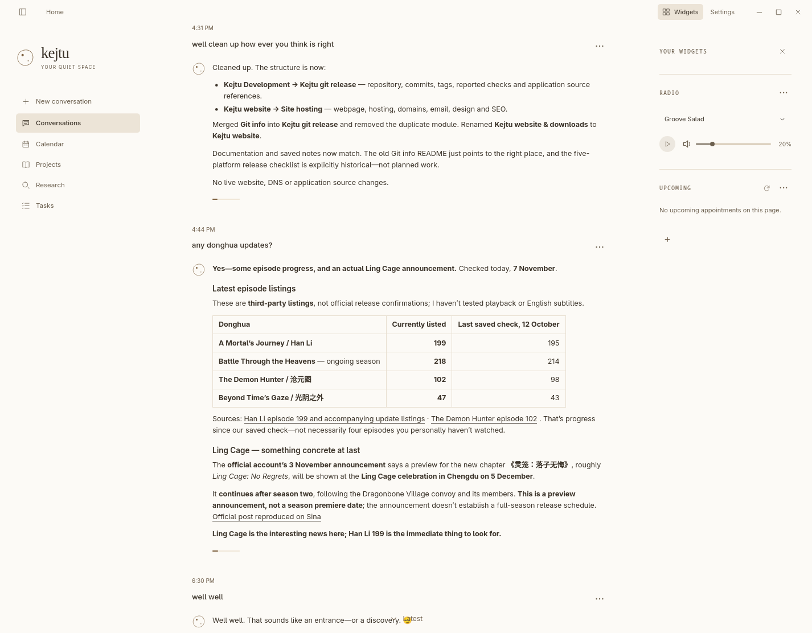
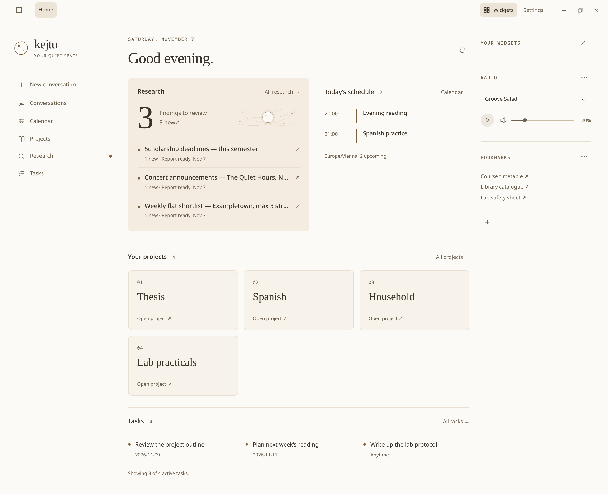

# Kejtu

A calm personal AI workspace that remembers what matters and can show you why.

Talk things through, plan your week, keep notes, organise projects and tasks,
research a topic and work on documents, all in one quiet desktop app. Your
conversations and notes are stored on your computer. You choose the model.

<p align="center">
  <a href="docs/images/kejtu-conversation.png"></a>
  <a href="docs/images/kejtu-home.png"></a>
</p>

## What makes it different

**Memory you can check.** Kejtu keeps a versioned notebook beside your
conversations. Each note records how it came about: saved by you, written during
a conversation, or added by Kejtu's own reflection. Earlier versions and
corrections are kept.
When Kejtu recalls something, it can read the exact original back to you. You can
exclude any exchange from recall or delete it.

**It remembers well.** In a full run of LongMemEval-S, a benchmark of 500
questions about long chat histories, 466 of Kejtu's answers passed automatic
grading (93.2%). Every case was counted, with no retries or manual corrections.
[Results, setup and caveats](docs/evaluation.md).

**Quiet by design.** Kejtu feels more like a journal than a chat feed: soft
transitions and little competing for your attention. A small figure shows what
Kejtu is doing while it works: gathering its thoughts, searching, reading or
writing.

**Local, with the model you choose.** Conversations, notes and settings live on
your machine. Connect a local model through Ollama, or an online service:
DeepSeek, Kimi, the OpenAI API or your ChatGPT plan. An online service receives
the messages and context needed for each reply.

**Clear permissions.** Folders, web access, tools, notes, tasks and People each
have their own setting. Kejtu never automatically repeats an action whose outcome
was uncertain.

## What you can do with it

- **Think and write.** Plan, draft and work through problems, with earlier
  conversations Kejtu can search and quote exactly.
- **Organise.** Projects with sections and resources, personal tasks with due
  dates, and a local calendar that can suggest study or work slots.
- **Learn.** Practise material one question at a time, with hints and feedback.
- **Work on documents.** Read and edit PDF, Word and Markdown files from folders
  you share.
- **Research.** Search and read the web with Tavily (works without a key), Brave
  or SearXNG. Kejtu can repeat a research task on a schedule and keep sourced
  reports.
- **Extend.** Add skills (reusable procedures) and MCP tools, each with explicit
  grants.

## Install on Manjaro

This is an early release for 64-bit Manjaro. You install it from source, so the
first setup takes time and needs an internet connection.

Download or clone this repository into the folder where you want to keep Kejtu.
Open a terminal in that folder and run:

```sh
python3 packaging/source/install.py --install
```

The installer downloads the tools Kejtu needs and builds the app. It may ask for
your password to install missing system packages. If Python or Git is missing,
install them first with `sudo pacman -S --needed python git`.

When setup finishes, open **Kejtu** from your application menu. In **Settings**,
connect your preferred AI service or local model. No model or paid account is
included. Help is available inside the app under **Settings → Help**.

> **Memory search by meaning requires a separate GPU setup.** The installer
> does not include it. See the [memory search requirements](docs/install.md#memory-search-requires-a-separate-gpu-setup).

Keep the installation folder where it is. See the [installation guide](docs/install.md)
for updates, backups and help with setup.

## Still in development

Expect bugs and unfinished parts. Video playback and editing existing PDFs still
need testing. Keep backups of anything important.

Manjaro is the focus of this release. Other platforms are not maintained as part
of it. Community ports and contributions are welcome.

[Documentation](docs/README.md) · [Credits](CREDITS.md) · [MIT license](LICENSE)
